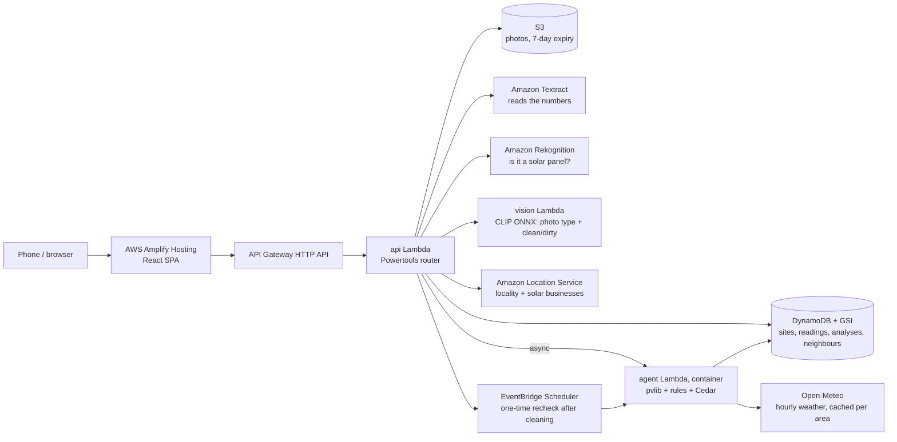

# SuryaCheck

**Find the money your rooftop solar is quietly losing, measured against the real sunshine on your roof.**

**Live app:** **https://bit.ly/4B0WI5e** (opens https://main.d2tnx3nqu0sqfs.amplifyapp.com)
· [Try a sample roof](https://main.d2tnx3nqu0sqfs.amplifyapp.com/test?sample=demohemant01) (no photos needed)
· Demo video: *link coming soon*
· [Write-up](docs/WRITEUP.md)
· [Blog: how we built it](https://builder.aws.com/post/3KY3vP3Q5R32HQ6jQHdM1ht1PBW_p/how-we-built-suryacheck-for-environmental-hacks-2026) (AWS Builder Center)

Built for **Environmental Hacks 2026, Waste & Energy track**. Free to use: no sign-up, no app install.

---

## The problem

Lakhs of Indian homes have installed rooftop solar under PM Surya Ghar. Their owners see one number in
the inverter app, say "12.4 kWh today", and nothing to judge it against. Was that good? After the
monsoon, dust settles on the panels day after day. A dead string or a tripping inverter can also
quietly take 10–25% of the output. Inverter alarms fire only on hard failures, so a home can lose a
few hundred rupees a month for a year before anyone looks at the roof.

**The inverter shows output. Nobody shows the shortfall.**

## What SuryaCheck does

Open the link and press **Test your roof**. It asks two things: where the roof is (from your
location) and its size (prefilled as 3 kWp).

1. **Photograph your inverter** display or app. One day's units are enough, and a screenshot of the
   app's daily list adds weeks at once. Amazon Textract reads the numbers, and you confirm them as
   editable chips. Optionally add the net-meter reading and 1–3 panel photos.
2. **SuryaCheck fetches the sunshine for your roof**: hourly irradiance and temperature from
   Open-Meteo for those exact days.
3. **It compares** what your panels made with what that sunshine allowed. The open-source **pvlib**
   solar model computes the second figure for your size, tilt and direction.
4. **You get one answer**, on the same page:
   - **one verdict word:** Healthy, Dust, Possible fault, Weather, or Below expected for a one-day
     quick check;
   - **one sentence**, e.g. *"Your panels made 15% less than the sunshine allowed, most likely dust"*;
   - **the money:** ₹ lost this month, ₹ over the next 12 months if left, and ₹ recovered per
     cleaning (one-day checks show ₹ lost that day instead);
   - **real solar businesses nearby** (Amazon Location Service), with Call, WhatsApp and a booking
     request;
   - **after a cleaning, an automatic recheck** that tells you whether the money actually came back.

The landing page has a live dust panel. Wipe it with your finger to watch output and rupees change,
using the same soiling model as the report.

| Sample roof (dust) | One-reading quick check | Cleaners nearby |
|---|---|---|
| 85% of what the sun allowed, **Dust**, ₹366 a month | 10.5 kWh vs 14.7 allowed, **₹25 lost that day** | 5 real solar businesses within 30 km, Call / WhatsApp |

## Why you can trust the number

**Code computes every number, verdict and action.** No language model guesses anything.

- **Expected output:** pvlib (Hay–Davies sky model, Faiman cell temperature, PVWatts DC and
  inverter, 14% fixed system losses) fed with Open-Meteo hourly weather for your coordinates.
- **Your normal:** your best 7 clear days in the last 90 days, so a roof that was always a bit low
  isn't blamed for it. With fewer than 7 clear days, the physics estimate is your normal and the
  result is labelled a quick check.
- **Cloudy days are excluded** from the verdict, because modelled irradiance is uncertain on them.
- **Fixed, published rules** ([backend/physics/rules.py](backend/physics/rules.py)):

  | Verdict | Rule (simplified) |
  |---|---|
  | **Dust** | Output slides 5–30% since the last rain (≥ 5 mm) or cleaning; the slope's 95% upper bound is below zero |
  | **Possible fault** | A sudden drop of 15% or more that holds for 3+ clear days, while neighbours stay steady |
  | **Inverter trip** | Near-zero output on a clear day |
  | **Weather** | Nearby roofs dipped by the same amount |
  | **Healthy** | 92% of normal or better |
  | **Below expected** | Quick check (1–6 clear days): below what the sun allowed; too little data to name a cause |

- **Rule test** on 300 simulated roofs with 3% daily noise: clean roofs read Healthy 99% of the time
  (1% false "dust"); dust at 0.6% a day was caught 300/300; a −30% string fault 300/300.
- **Safety gate:** every action (clean, message installer, wait…) must pass a
  [Cedar policy](backend/policies/actions.cedar). A dust verdict can never message an installer, and
  cleaning is recommended only when the monthly loss exceeds the cleaning cost.
  [tests/test_authz.py](tests/test_authz.py) checks the whole verdict × action × loss matrix.
- **One loss definition everywhere:** units below what the sunshine allowed on clear days, at your
  electricity rate. The 12-month projection starts at exactly that monthly figure, and a self-check
  asserts it.

Method details and limits: [/how-it-works](https://main.d2tnx3nqu0sqfs.amplifyapp.com/how-it-works)
and [docs/decisions.md](docs/decisions.md).

## Architecture



**Design rule:** models read and describe; code decides. Textract reads characters and our parser
decides which are dates and kWh; you confirm every value. The photo model gives a visual estimate
only, shown when it is at least 80% sure. The verdict always comes from measured output.

### AWS services, and why each is there

| Service | Job |
|---|---|
| **AWS Amplify Hosting** | Serves the React app (deployed by [scripts/deploy_frontend.py](scripts/deploy_frontend.py)) |
| **Amazon API Gateway (HTTP API)** | Public API with per-route throttling |
| **AWS Lambda** | `api` (zip), `agent` (container: pvlib, pandas, Cedar), `vision` (container: CLIP ONNX) |
| **Amazon DynamoDB** | Single table: sites, readings, analyses, actions, a weather cache, daily caps; a GSI on area (geohash) finds neighbours |
| **Amazon S3** | Uploaded photos, private, deleted after 7 days |
| **Amazon Textract** | Reads inverter screenshots (`DetectDocumentText`) and meter/LCD photos (`AnalyzeDocument` Queries) |
| **Amazon Rekognition** | Independently confirms "Solar Panels" in panel photos |
| **Amazon Location Service** | Locality name, area/PIN search, and real solar businesses near the roof |
| **Amazon EventBridge Scheduler** | One-time recheck a few days after a cleaning, to measure whether the money came back |
| **Amazon CloudWatch Logs** | Structured JSON logs (Powertools) |

**AWS open source:** [AWS SAM](template.yaml) (infrastructure and container builds),
[Powertools for AWS Lambda](backend/api/app.py) (routing, structured logging),
[Cedar](backend/policies/actions.cedar) (action authorisation via `cedarpy`).

## Data honesty

- **Sample roofs are simulated** and labelled "Sample data" everywhere:
  - "Hemant", dust;
  - "Meera", fault;
  - a cleaning replay whose recheck shows the money coming back.

  The weather is **real** (Open-Meteo for Chandkheda, Ahmedabad); only the performance applied on
  top is synthetic. [scripts/seed_demo.py](scripts/seed_demo.py) regenerates them and fails loudly
  unless each story's verdict holds.
- **Neighbours in the samples are simulated.** Real neighbour comparison needs many users in one area.
- **Your own test uses only your readings**, the real weather for your roof, and your confirmed numbers.
- **Cleaners** are real solar businesses from Amazon Location Service, not verified cleaners. No
  names, ratings or prices are invented. Booking requests are logged; emailing them is configured
  but switched off until an inbox is verified.

## Run it yourself

Prerequisites: an AWS account (region `ap-south-1`), AWS SAM CLI, Docker, Python 3.13, Node 22 (Vite 8).

```bash
python -m venv .venv && .venv/Scripts/pip install -r ml/requirements.txt   # dev + ML deps
python ml/build_heads.py                 # downloads the CLIP ONNX model the vision image copies
python -m pytest tests -q                # 69 tests: physics, rules, Cedar, parser, vision

echo DEMO_KEY=<any secret> > .env           # used by the deploy and the seed script
sam build --use-container
sam deploy --stack-name suryacheck --resolve-s3 --resolve-image-repos --capabilities CAPABILITY_IAM \
  --region ap-south-1 --parameter-overrides DemoKey=<same secret>

cd frontend && cp .env.example .env.production   # set VITE_API_URL to the stack's ApiUrl output
npm ci && npm run build && cd .. && python scripts/deploy_frontend.py
python scripts/seed_demo.py              # optional: the simulated sample roofs
```

Frontend self-checks: `node src/lib/money.check.ts`, `node src/site/dustScene.check.ts`,
`node src/lib/sun.check.ts`, all run from `frontend/`.

## Cost and guardrails

- **Daily caps** (atomic DynamoDB counters) on analyses, Textract reads, photo checks, new sites,
  place searches and booking requests. A script hammering the URL can't drain the account.
- **Weather is cached** per neighbourhood per day: one Open-Meteo call per area per day.
- Photos expire after 7 days. There are no accounts: each roof is keyed by an unguessable 12-character id.

## Limitations

- **A quick check** (1–6 clear days) compares with a typical healthy system and can't tell dust from
  a fault. Add more days (optional) for a firm cause.
- **Thresholds are engineering estimates**, validated on simulated roofs, not yet on field data.
- **Neighbour comparison** is simulated in the samples and needs real density to work.
- **The photo condition model** (clean/dirty) was trained on a public dataset with no stated licence.
  It is shown only when ≥ 80% confident (97.5% correct there on held-out photos), is labelled a
  visual estimate, and never decides the verdict. [docs/ML_PLAN.md](docs/ML_PLAN.md) replaces it
  with licensed data.
- **Screenshot reading** depends on the app's layout. That is why every number is confirmed by you.
- **The recheck in the samples is a seeded replay**, because a real 5-day recheck doesn't fit a 4-day event.
- **Open-Meteo's free tier is non-commercial** (CC BY 4.0). English only for now.

## What's next

- **Installers** onboarding their customers by area, which gives real neighbour density.
- Hourly analysis to separate shade from dust.
- Better photo and reading models ([docs/ML_PLAN.md](docs/ML_PLAN.md)).
- Discom net-meter integration.

## Data sources, models and licences

- [Open-Meteo](https://open-meteo.com) weather API: CC BY 4.0, free for non-commercial use.
- [pvlib](https://pvlib-python.readthedocs.io): BSD-3-Clause.
- [OpenAI CLIP ViT-B/32](https://github.com/openai/CLIP) (MIT), as the
  [Xenova ONNX export](https://huggingface.co/Xenova/clip-vit-base-patch32).
- The clean/dirty training photos are from Hugging Face `adityashirsatrao007/solar-dust-data-combined`,
  which has no stated licence (see Limitations).
- Place data: © Amazon Location Service and its data providers.

## AI tools used

- **Claude Code** (Anthropic) helped write, test and deploy the code.
- **CLIP**, an open image model run on our own Lambda, gives the visual photo estimate.
- **Amazon Textract and Rekognition** read the numbers and confirm panel photos.
- **Amazon Bedrock is not used.** The account's model access was still under AWS verification, so
  every explanation is built from computed numbers by fixed templates
  ([backend/physics/explain.py](backend/physics/explain.py)).

## Repository map

```
backend/api/       HTTP API (routes, validation, caps), Textract extraction, cleaners and bookings
backend/agent/     analysis pipeline (weather → pvlib → performance → rules) and recheck job
backend/physics/   yield model, performance metrics, rules, explanations, recheck maths
backend/policies/  Cedar policy for actions
backend/shared/    DynamoDB helpers, caps, geohash, readings parser, CleaningProvider adapter
backend/vision/    CLIP ONNX classifier (photo type + clean/dirty)
frontend/          React + Vite app (landing, /test flow and results, history, settings)
ml/                head building, probe training, ML requirements
scripts/           deploy, seed, end-to-end checks, icon generation
tests/             pytest suite
docs/              decisions log, write-up, ML plan
```
