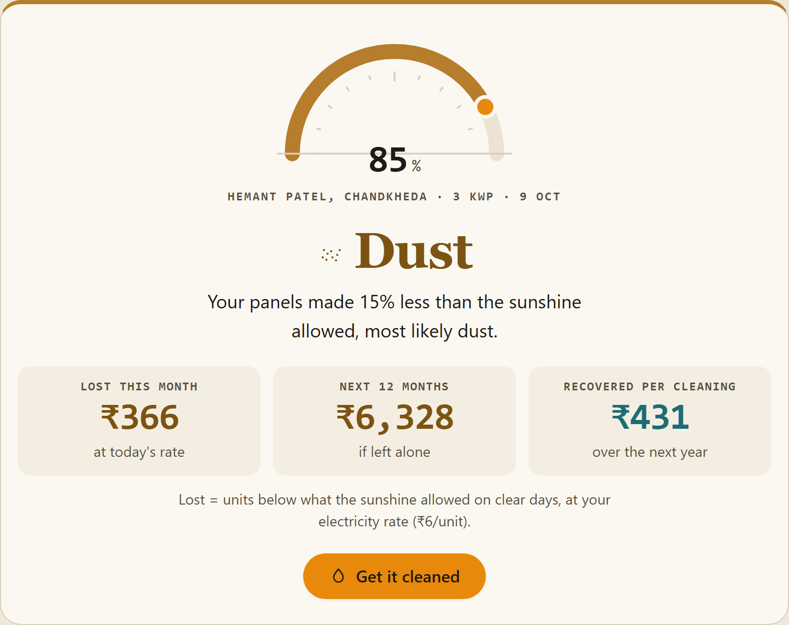
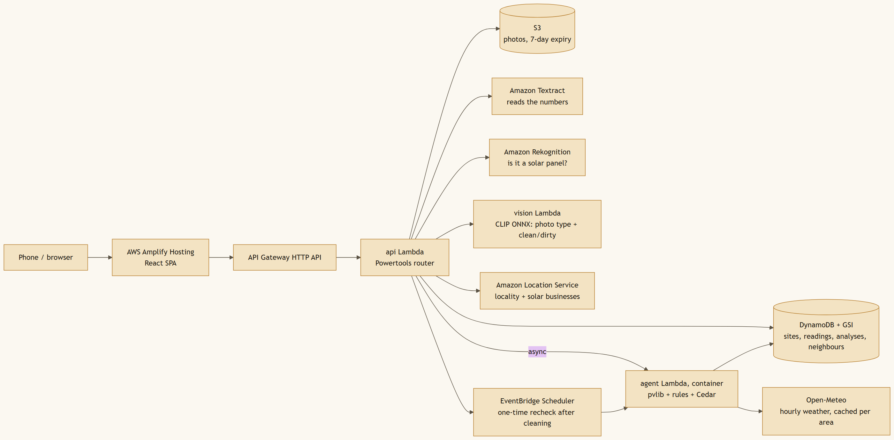
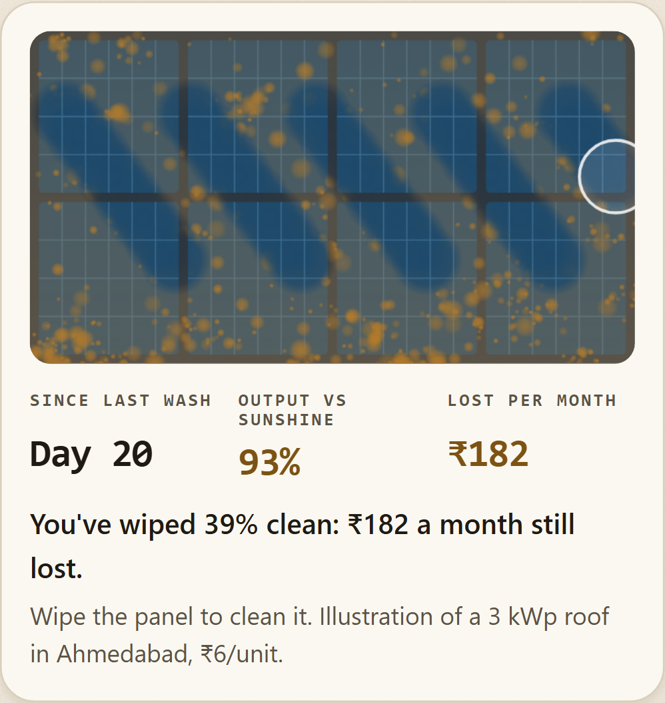

# Code decides, models only read: diagnosing rooftop solar with pvlib, Textract and Cedar

*How we built SuryaCheck for Environmental Hacks 2026: an app that finds the ₹300 a month dust
quietly steals from Indian rooftops.*

> **The short version.** Rooftop solar owners in India see one number, "12.4 kWh today", and
> nothing to judge it against. SuryaCheck takes one photo of the inverter app, fetches the real
> sunshine for that roof, computes with pvlib what the panels *should* have made, and turns the gap
> into a verdict (Healthy, Dust, Possible fault) and a rupee figure. Models only read: Amazon
> Textract reads digits, and an open image model gives a visual dust estimate. Code decides every
> number, every verdict and every action, and a Cedar policy gates what the app may do. It runs
> serverless on AWS, and so far this month the bill is **$0.03**.
> Live: **https://bit.ly/4B0WI5e**

## The problem: output, never shortfall

Lakhs of Indian homes have installed rooftop solar under PM Surya Ghar, and Gujarat is ahead of most
states. Every owner gets an inverter app that shows how many units the panels made today. None of
them shows how many the panels *should* have made.

That gap is where the money goes:
- **Dust.** After the monsoon withdraws, there is no rain for weeks, and dust settles day by day.
  Output slides a fraction of a percent each day.
- **Faults.** A dead string or a tripping inverter takes a step out of the output overnight.

Inverter alarms fire only on hard failures. A 3 kW home can lose a few hundred rupees a month, plus
the clean energy it paid for, for a year before anyone climbs onto the roof.

So the product question was simple: **what did the sunshine on your roof allow today, and how far
short were you?**

## What we built

You open the link and press **Test your roof**. The app asks two things: where the roof is (browser
location, photo GPS, or a PIN code) and its size, prefilled at 3 kWp.

1. **One photo of the inverter** display or app. One day's units are enough, and a screenshot of
   the daily list adds weeks at once. Textract reads the numbers, and you confirm them as editable
   chips.
2. The backend fetches **Open-Meteo** hourly irradiance and temperature for your coordinates.
3. **pvlib** computes what the panels should have made: the Hay–Davies sky model, Faiman cell
   temperature, PVWatts DC and inverter, and 14% fixed system losses.
4. **Fixed rules** compare the two. You get one verdict word, one plain sentence, and the money:
   lost this month, over the next year, and recovered per cleaning.
5. The same page lists **real solar businesses nearby** (Amazon Location Service). After a cleaning,
   **EventBridge Scheduler** runs a recheck that measures whether the money came back, against the
   same baseline.





The design rule shaped every decision: **models read and describe; code decides.** Textract turns
pixels into characters, and our own parser decides which are dates and which are kWh. The photo
model's dust estimate is shown only when it is at least 80% sure, and it never touches the verdict.
Actions pass through a Cedar policy:

```cedar
// Dust: clean only when the monthly loss pays for the cleaning; otherwise wait (saves water).
permit (principal, action == Action::"CLEAN_PANELS", resource is Analysis)
when { ["SOILING", "STEADY_LOSS"].contains(resource.verdict)
       && resource.monthly_loss_inr >= resource.cleaning_cost_inr };

// Electrical problems go to the installer, never to a cleaner.
permit (principal, action == Action::"MESSAGE_INSTALLER", resource is Analysis)
when { ["FAULT", "INVERTER_TRIP"].contains(resource.verdict) };
```

A pytest suite checks the whole verdict × action × loss matrix against these rules, so the policy and
the code cannot drift apart. The rest of this post is about what fought back.

## 1. The clean roof our own test called dusty

Dust is a slow slide in output since the last rain. The first version measured the slide as "the
latest 3-day median vs the start of the dry spell". It looked fine on our three hand-made demo roofs.

Then we wrote a test that generates 300 simulated roofs on real Ahmedabad weather, each with 3% daily
noise. It runs the rules on all of them and counts wrong verdicts. Clean roofs came back as "Dust".
The noisy 3-day median occasionally dipped far enough to fake a decline, and with nobody checking
whether the slope was statistically real, one bad week was enough.

The fix was to measure the decline along a robust fitted trend, and to require the slope's upper 95%
bound to be below zero:

```python
slope, _, _, high = theilslopes(seg.values, x)      # Theil–Sen: robust to a few bad days
# Decline along the fitted trend, so one noisy recent day cannot fake it.
seg_slope, seg_slope_high, seg_decline = float(slope), float(high), float(-slope * x[-1])
```

After the fix, on the same 300 roofs:
- clean roofs read Healthy 99% of the time (1% false "dust");
- dust at 0.6% a day was caught 300/300;
- a −30% string fault was caught 300/300.

**Lesson:** test a rule on hundreds of noisy cases, not on the three roofs you designed it for.

## 2. The weather API that invented an inverter trip

The first analysis on real weather reported an **inverter trip** on the first day of the window: the
system had supposedly produced 0 kWh on a sunny day. Nothing was wrong with the roof.

Open-Meteo returns **hour-ending** timestamps. A request starting at local midnight therefore gives
the first day only a few hours, and pvlib correctly computed almost no expected energy for it. Our
data had a near-zero "actual" for that partial day, which matched the inverter-trip rule exactly:
near-zero output on a clear day.

```python
# Drop partial days at the edges of the request (fewer than 24 hourly values).
hours = pd.Series(1, index=hourly.index).groupby(day).sum()
daily = daily.loc[hours[hours >= 24].index]
```

Three lines, and it is one of the most important fixes in the project. A diagnosis tool that cries
"fault" on day one never gets a second chance.

## 3. The dust model that scored 87% and then 55%

We wanted a visual check alongside the numbers: point the camera at the panels and get "looks clean"
or "looks dirty". We run OpenAI's CLIP (MIT licence) as a quantised ONNX model in its own Lambda
container: numpy and onnxruntime, no PyTorch, about 1 second per photo once warm.

Zero-shot CLIP ("a photo of a dusty solar panel" vs "a clean solar panel") was close to a coin
toss. So we trained a small logistic-regression probe on CLIP embeddings, using 3,029 labelled panel
photos from a public dataset:

| Clean/dirty model | Held-out test | Real-world photos (Wikimedia, never trained on) |
|---|---|---|
| Zero-shot CLIP prompts | not measured | 6 of 12 right, at ~35% confidence |
| Trained probe, every prediction | **86.9%** | **55%** |
| Trained probe, **only when ≥ 80% confident** | **97.5%** (195/200), shown on ~half of photos | **8 of 9** shown were right |

The training photos were phone close-ups; real users and Wikimedia shoot wide rooftop views. That
domain shift explains the drop from 87% to 55%. Rather than ship a coin toss, the app shows a
condition only when the model is confident, and labels it "Visual estimate. The verdict comes from
your measured output."

```ts
const CONFIDENT = 0.8   // test set: 97.5% right when shown at 0.8 vs 91% at 0.6
```

**Being honest about it:** that dataset has no stated licence. The model is useful as a demo, and our
[ML plan](https://github.com/RajvardhanJhala/suryacheck/blob/main/docs/ML_PLAN.md) replaces it with
licensed data and real Indian rooftop photos before it goes anywhere further.

## 4. When the cloud said no (three times)

**Bedrock.** The plan used an LLM to write the explanation and to break ties between near-equal
verdicts. Every model call returned:

```
AccessDeniedException: Your account is currently being verified
```

It stayed that way for the whole event. Because the design already said "code decides", losing the
model cost us only prose. `physics/explain.py` builds every headline and "what to do" line from
computed numbers, and the product works without a single LLM call. In hindsight, that is the version
we'd want in front of a homeowner anyway.

**Amazon Location Service.** Searching "solar panel cleaning" with a position bias near Ahmedabad
returned businesses in El Paso, Noordhoek and Stratford. With a strict 30 km circle the same query
returned zero results. Broader queries ("solar system", "solar energy", "rooftop solar") found 17
real businesses within 30 km. So we search those, keep only names containing "solar", drop clothing
and furniture shops that happen to be called "Solar", and say on the page: *solar businesses, not
verified cleaners*. WhatsApp shows only for Indian mobile numbers, because landlines can't receive
it.

**The laptop.** Mid-deploy, Docker crashed into a read-only state: the C: drive was full. Every
deploy had left another 1.4 GB copy of the analysis container image behind: eleven of them.
Clearing pip and npm caches (about 7 GB) and the stale images got us going again. For container
Lambdas, prune your local images.

## 5. The bug that passed every test

On the last day I tried the app on my own phone, filled in everything, pressed **Check my roof**, and
got:

```
source must be screenshot, csv or manual
```

Every test had passed. Our browser tests used the **Upload** button, which labels readings as a
screenshot. On a phone you naturally press **Take photo**, which labelled them `photo`, a value the
API didn't accept. The second phone bug was hiding behind the first: a camera photo was read as a
single "today" value, so photographing the app's daily list gave one day instead of three weeks.

```python
if source not in ("screenshot", "photo", "csv", "manual"):
```

Both fixes were small: accept `photo`, and read camera photos as a daily list first, falling back to
the single "Today" number. The lesson wasn't. **Test the path real people take, on the device they
use.** We now run the end-to-end flow on emulated Pixel and iPhone profiles, and on a simulated older
browser without `canvas.roundRect`, which would otherwise have taken down the landing page.

The same day, Lighthouse showed a mobile performance score of 71. The cause was layout shift: web
fonts swapping in after first paint reflowed the hero. Switching fontsource to
`font-display: optional` with a tiny Vite build hook fixed it:

| Landing page, mobile Lighthouse | Before | After |
|---|---|---|
| Performance | 71 | 86–96 (median 93) |
| Cumulative layout shift | 0.274 | **0** |
| Accessibility | 97 | 100 |
| Best practices / SEO | 100 / 100 | 100 / 100 |



## What it runs on, and what it costs

Everything is defined in one AWS SAM template and deployed to Mumbai (`ap-south-1`):

- **AWS Amplify Hosting** serves the React app.
- **API Gateway (HTTP API)** with per-route throttling.
- **Three Lambdas:**
  - `api`: zip, Powertools router;
  - `agent`: a container with pvlib, pandas and Cedar;
  - `vision`: a container with CLIP ONNX.
- **DynamoDB**, one table with a geohash GSI that finds neighbours in one query.
- **S3** for photos, deleted after 7 days.
- **Textract**, **Rekognition**, **Amazon Location Service**, and **EventBridge Scheduler** for the
  recheck.

Every analysis logs one structured line (Powertools), which made debugging a matter of reading JSON:

```json
{"level":"INFO","message":"analysis done","service":"suryacheck","cold_start":false,
 "function_name":"suryacheck-agent","function_memory_size":"1536",
 "verdict":"SOILING","monthly_loss_inr":303.0}
```

**Cost so far this month, before credits: $0.03.** That is about $0.01 each for Rekognition, Location
Service and DynamoDB. Lambda, API Gateway, S3, Textract and Amplify each came to under a cent,
mostly thanks to the free tier.
Cost Explorer lags about a day, so the final number will be a little higher.

Three things keep it that way:
- **Daily caps:** atomic DynamoDB counters on analyses, Textract reads, photo checks and place
  searches, so a script hammering the public URL can't drain the account.
- **A weather cache** per neighbourhood per day: one Open-Meteo call per area per day.
- **No always-on compute:** the ML model is an ONNX file in a Lambda, not an endpoint billed by the
  hour.

## Three things I would tell myself on day one

1. **Decide early what the model is *not* allowed to do.** "Code decides, models only read" turned
   Bedrock's outage from a crisis into a footnote. It also made the Cedar policy, the tests and the
   honest UI copy almost obvious.
2. **Every number needs one definition.** For a while the money page projected the year from its own
   estimate of today's loss, while the headline used the backend's figure, so the two could
   disagree. Now there is one loss definition (units below what the sunshine allowed on clear days,
   at your rate), and a self-check asserts that the 12-month projection starts at exactly that
   figure.
3. **Ship the honest version of a weak result.** A one-day reading can't tell dust from a fault, so
   the app says "Below expected: ₹25 lost that day; add more days to tell dust from a fault" instead
   of guessing. The 87%-then-55% dust model is shown only when it's confident. Users trust a tool
   that admits what it doesn't know.

---

**Try it:** https://bit.ly/4B0WI5e (no sign-up; "Try a sample roof" needs no photos)
· **Code:** https://github.com/RajvardhanJhala/suryacheck
· **Demo video:** *link coming soon*

Built for **Environmental Hacks 2026** (Waste & Energy track), with Claude Code as a pair programmer.
Sample roofs and their neighbours are simulated on real weather and labelled as such.

*The opinions in this post are my own and do not necessarily reflect those of AWS.*
